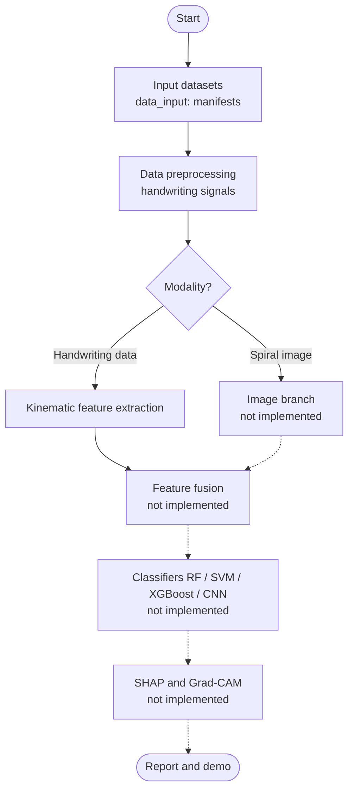

# Project Notes: SHAP-driven Multimodal Framework for Early Parkinson's Disease Detection via Handwriting and Spiral Analysis

**Course:** Major Project-I, B.Tech CSE & IT, Jaypee University of Information Technology (JUIT)
**Group:** 22
**Team:** Tanish Sharma (231030199), Agniprabha Ganguly (231030206), Bhumika Chadha (231030036)
**Supervisor:** Dr. Hari Singh, Associate Professor
**Status date:** 12 November 2026
**Repository:** `/Users/krsna/pd-multimodal`

> This is a research project. It is not a medical device and must not be used for diagnosis.

---

## 1. Overview and Objectives

Parkinson's disease (PD) affects handwriting and drawing. Early changes often appear as slower movement, longer pauses in the air, pressure changes and a tremor-like oscillation in the pen path. Spiral and handwriting tests are cheap and non-invasive, so they are a plausible screening route.

The project aims to build a screening model that combines two evidence sources:

1. **Image evidence:** scanned or photographed drawings (spirals, meanders, circles, waves).
2. **Signal evidence:** pen or tablet trajectories recorded while the subject writes or draws.

The objectives are:

- Build one merged, de-duplicated and labelled dataset from several public sources, with subject-level grouping so that no person appears in both training and test data.
- Extract interpretable kinematic features from handwriting signals.
- Train unimodal and fused classifiers (Random Forest, SVM, XGBoost, and a CNN for images).
- Explain every prediction with SHAP (and Grad-CAM for images), and check whether the explanations agree with known PD signs.
- Evaluate with grouped within-cohort cross-validation and leave-one-cohort-out (LOCO) validation, so that the cross-dataset claim is tested.
- Provide a Streamlit demo that is labelled as a screening aid.

### Current state (12 November 2026)

| Component | Status |
|---|---|
| Dataset builder (`scripts/build_dataset.py`) | Complete |
| Data routing (`data_input/`) | Implemented |
| Signal preprocessing (`preprocessing/`) | Implemented |
| Kinematic feature extraction (`kinematic_features/`) | Implemented, one run completed |
| Image branch (spiral features, CNN) | Not implemented |
| Feature fusion | Not implemented |
| Classifiers (RF, SVM, XGBoost, CNN) | Not implemented; no model has been trained |
| SHAP and Grad-CAM | Not implemented |
| Streamlit demo | Not implemented |

No classifier has been trained. No accuracy, sensitivity or AUC has been measured. Nothing in this document is a performance claim.

---

## 2. Flowchart Implemented So Far

The intended pipeline is shown below. Nodes marked "not implemented" are planned; the other steps are in the repository.



**Order note.** The flowchart places preprocessing before the modality decision. In the code, `data_input/load_data.py` performs the modality split first. Preprocessing is then applied only to the handwriting (signal) branch, so the result is the same. The implemented path is: Start, input datasets (manifests built by the dataset builder), modality routing, preprocessing of handwriting signals, and kinematic feature extraction.

Spiral images are routed to the image branch by `route_by_modality()`, but no image feature code exists yet.

---

## 3. Datasets

### 3.1 Dataset totals

| Modality | Samples | Subject groups | PD groups | HC groups |
|---|---|---|---|---|
| Images (scan + rendered) | 2963 (1450 scan, 1513 rendered) | 376 | 239 | 137 |
| Signals (pen / tablet) | 2385 | 260 | 148 | 112 |

Label convention: `1` = PD, `0` = healthy control (HC). Subject groups are merged subject IDs (see section 3.4). A rendered image is a picture of a signal's x, y trajectory, so rendered and signal samples describe the same recordings.

### 3.2 Per-source summary

Subject counts are after de-duplication. For signals, the counts come from `load_data.py`. For images, they come from `DATASET_CARD.md`.

| Source | Task(s) | Modality | HC subjects | PD subjects | License (as stated in sources) | How obtained |
|---|---|---|---|---|---|---|
| UCI 395: Parkinson Disease Spiral Drawings Using Digitized Graphics Tablet | Static spiral, dynamic spiral, circle (STCP) | Tablet signals (x, y, pressure, grip angle, z) | 15 | 62 (signals). Plus 25 PD drawings (PD by inference) | CC BY 4.0 | Builder downloads UCI archive |
| UCI 358: Improved Spiral Test (same authors) | Static and dynamic spiral | Tablet signals | 5 files kept, mapped to UCI 395 subjects (adds 0 new groups) | 0 | CC BY 4.0 | UCI archive. 35 of 40 files are byte-identical to UCI 395 and skipped |
| HandPD (2016) | Spiral, meander | Scanned drawings | 11 (spiral) | 50 (spiral), 51 (meander) | None stated; academic use with citation | UNESP download (`wwwp.fc.unesp.br`) |
| NewHandPD (2016) | Spiral, meander, circle (on paper); circle in air; diadochokinesis A and B (smart pen) | Scans and smart-pen signals (no x, y) | 35 | 25 after merge (31 subject IDs before merge) | Not stated in DATASET_CARD | UNESP download |
| Kaggle kmader/parkinsons-drawings (via GitHub mirror `widushan`) | Spiral, wave | Scanned drawings | 13 | 15 | Not stated in DATASET_CARD | GitHub mirror; Kaggle CLI not used |
| PaHaW public examples (BDALab `handwriting-features`) | Spiral, handwriting tasks 2 to 14 | Tablet signals (x, y, pressure, azimuth, altitude, button) | 2 | 2 | MIT (BDALab repository) | Git clone |
| HandyDiag v1.0 (Thai handwriting, 2026) | Spiral, vertical and horizontal lines, words, Thai sentence (both hands) | Tablet signals | 60 | 59 | Non-commercial research and education only | GitHub `suchadat/HandyDiag_v1.0` |
| Kaggle mohammedawais505 (phone photos, staged by hand) | Spiral | Phone photographs | 1 group (83 samples) | 1 group (71 samples) | As stated on Kaggle (not recorded in DATASET_CARD) | Manual drop in `data/raw/manual/images/` |

Notes:

- The UCI 395 drawings (25 static and 25 dynamic PNGs) are labelled PD by inference. The count matches the 25 PWP patients, and UCI describes them as patient drawings. They cannot be linked to the signal files, so each gets its own subject ID (`uci395_drawing_NN`).
- The kmader split (`split_hint`) leaks subjects and is ignored.
- The Kaggle phone-photo subjects are undocumented. Each label is therefore treated as one subject group.

### 3.3 Signal and image counts by task

Signal counts (from `load_data.py`, subject groups by source and label):

| Source | HC | PD |
|---|---|---|
| handydiag | 60 | 59 |
| newhandpd | 35 | 25 |
| pahaw_examples | 2 | 2 |
| uci358 | 5 | 0 |
| uci395 | 15 | 62 |

Spiral image counts (samples and subject groups, after de-duplication, from the `DATASET_CARD.md` table and `load_data.py`):

| Source | HC samples / subjects | PD samples / subjects |
|---|---|---|
| handpd (spiral) | 44 / 11 | 200 / 50 |
| newhandpd (spiral) | 140 / 35 | 104 / 26 |
| kmader_drawings (spiral) | 51 / 13 | 51 / 15 |
| uci395 (static and dynamic spiral drawings) | 0 | 50 / 25 |
| manual_kaggle_awais_phone (spiral) | 83 / 1 | 71 / 1 |

`load_data.py` routes 794 spiral scans to the image branch, covering 176 subject groups (60 HC, 116 PD). Subject groups are merged across sources, so the group counts do not add up to the source counts.

### 3.4 Why PaHaW is only four example subjects

PaHaW (Parkinson's Handwriting database, BDALab, Brno University of Technology) is the most useful source for kinematics. It has 75 subjects (37 PD and 38 HC) with tasks including spirals, letters, words and a sentence. The full database requires a signed license request to BDALab. That request has been drafted (`docs/data_requests.md`, section 1), but the request log is blank, so no send is recorded.

The only public copy available without a request is the BDALab `handwriting-features` example folder. It holds 4 subjects (2 HC, 2 PD). The builder uses these as `pahaw_examples`. They are enough to test the feature code, but they are far too few for any model claim. The plan keeps these 4 subjects as the fallback if the license is not granted.

The builder also accepts the full licensed database if it is placed in `data/raw/manual/pahaw/`. Files identical to the examples are skipped, and the source is then recorded as `pahaw_full`.

### 3.5 Subject-overlap handling

Splitting on sample or on `subject_id` would inflate accuracy, because the same person can appear many times. The dataset handles this in four ways:

1. **`subject_group` for all splits.** Subject IDs that share any identical image are merged into one group with a union-find step. The merges are listed in `subject_groups_merged.csv` (67 rows).
2. **Exact duplicate removal.** Images with the same MD5 are kept once. The NewHandPD copy is preferred because it links to the smart-pen signals. 288 duplicate images are listed in `images_dropped_duplicates.csv` (244 HandPD copies and 44 NewHandPD copies). The labels of every duplicate pair agree, and the builder asserts this.
3. **Near-duplicate flagging.** Images whose 32x32 thumbnail correlation is at least 0.95 are flagged in `overlap_flag` but not dropped. Eight images in total are flagged this way (`images_manifest.csv`, `overlap_flag` starts with "near-dup").
4. **Cohort merging.** HandPD and NewHandPD are treated as one cohort. UCI 395 and UCI 358 are treated as one cohort. These are not independent datasets.

Residual overlap remains. The remaining HandPD and NewHandPD subjects may still be the same people, and the UCI drawings may come from the same people as the UCI PD signal subjects. The `ID_PATIENT` column in `NewSpiral.csv` is inconsistent (for example, healthy subjects carry IDs that HandPD uses for patients), so it is not used for mapping.

### 3.6 Kaggle sets checked

All Kaggle sets were downloaded with the Kaggle CLI into `data/raw/kaggle/` and checked by MD5 and by a rotation- and flip-invariant 32x32 correlation against the existing raw data.

| Kaggle dataset | Decision | Reason |
|---|---|---|
| `mohammedawais505/parkinsons-detection-spiral-drawings-dataset` | Accepted (154 new phone-photo spirals, staged by hand) | 102 of 256 images duplicate kmader spirals. The 154 new images (83 HC, 71 PD) are new. Subjects are undocumented, so one group per label |
| `aashiqa/parkinsonsdataset` | Rejected | 1902 images (HandPD, NewHandPD, kmader). All are MD5-identical to existing data |
| `asthamishra96/parkinson-multi-model-dataset-2-0` | Rejected | Licence unknown, 2.5 GB. Spiral and wave drawings (204) are MD5-identical to kmader. Other modalities (voice, DaTSCAN, MRI, ECG) are outside this project's scope |
| `fatmabaccouche/parkinson-detection` (Roboflow, CC BY 4.0) | Rejected | Resized to 640x640, histogram-equalised and augmented 2x. 3373 match existing images under rotation or flip. No originals |
| `adritachakrabarti/ndegdis-datasets` | Rejected | 662 of 747 images MD5-identical to kmader and UCI 395. 73 are bipolar-disorder handwriting (not PD). 12 are unlabelled augmentations |
| `dhiaeddinear/parkinson-drawings` | Rejected | kmader plus augmented ("Gen") copies |
| `mohammadrezabaqery/parkinson-dataset` | Rejected | kmader duplicate (204 of 209 match; 5 near-copies) |
| `jallipallisaibalaji/parkinson-drawing-images` | Rejected | Roboflow object-detection export, augmented, mostly duplicates |
| `anoushkasud/parkinson-spiral-test` | Rejected | 35 renders, only 3 unique, likely derived from UCI |

---

## 4. Failed and Dead-End Paths

Only attempts recorded in the project sources are listed here.

| # | Path | What happened | Reason | Decision |
|---|---|---|---|---|
| 1 | Full PaHaW download | Blocked | Signed license needed from BDALab | Request drafted. Use 4 public example subjects until granted. Request log blank |
| 2 | Kaggle `kmader/parkinsons-drawings` via Kaggle CLI | CLI not installed at first; needs login | Setup and login | Used GitHub mirror `widushan` (identical content). CLI later installed for other Kaggle sets |
| 3 | kmader original train/test split | Subjects appear in both splits | Leakage | Rejected. `split_hint` ignored |
| 4 | UCI 358 as an independent source | 35 of 40 files byte-identical to UCI 395; drawings identical | Adds almost nothing | Kept 5 non-identical files, mapped to UCI 395 subjects. Drawings not re-added |
| 5 | HandPD and NewHandPD as independent datasets | 288 byte-identical scans; 30 HandPD subjects re-shipped | Cannot validate one against the other | Merged into one cohort and grouped by `subject_group` |
| 6 | `NewSpiral.csv` `ID_PATIENT` for subject mapping | IDs inconsistent | Healthy subjects carry patient IDs | Abandoned |
| 7 | NewHandPD smart-pen signals for trajectory rendering | No x, y coordinates | Device records pressure and sensors only | No rendered images. Kinematic features set to NaN with `has_xy = 0` |
| 8 | `musaru/PD_PaHaW` | Only derived feature CSVs | No raw signals | Not used |
| 9 | `khareyash05/...` | Only models and notebooks | No data | Not used |
| 10 | `IoannisKansizoglou/DrawingAwarePDdetection` | Only figures | No data | Not used |
| 11 | `ManasaGadepalli/...` | Only a NewHandPD manifest | No new data | Not used |
| 12 | `sayakpaul/Parkinson-s-Disease-Classifier` | Only kmader wave images | Redundant | Not used |
| 13 | PADS on UCI (guessed ID 468) | HTTP 404 | Dataset is on PhysioNet and is smartwatch motion data, not handwriting | Not used. Optional motion branch only if time permits |
| 14 | HandPDMultiMC (21 PD / 21 HC) | No public download found | Data on request only | Request drafted to the corresponding author. Drop if no reply in 2 weeks (plan) |
| 15 | Mendeley `fd5wd6wmdj` | All 254 images MD5-identical to kmader and UCI 395 | Duplicate | Rejected |
| 16 | GitHub `shalusingh-tech/Spiral_pd_dataset` | 310 images, all MD5-identical to HandPD/NewHandPD. Archive dead | Duplicate | Rejected |
| 17 | GitHub `seensiravit/Parkinson-SpiralDrawing` | 447 images re-encoded from HandPD, NewHandPD and kmader. `degrade` folders augmented | Provenance | Rejected |
| 18 | Zenodo 7967603 | PD-only handwriting outcome scores (SPSS) | Not usable for classification | Rejected |
| 19 | Zenodo 15831979 (PARKINSON BRASIL spirals, 15 HC / 24 PD) | Restricted access | Request needed | Request route noted; no request logged |
| 20 | Cc-PhD (PLOS ONE 2025, `dreamhcy/MLforPD`) | Application form only | Application needed | Draft noted; new parser needed |
| 21 | DraWritePD | Only segmentation code public | Data not public | Request drafted to TalTech |
| 22 | PLOS figshare 1034789 (Smits et al.) | Figures and methods only | No raw data | Rejected |
| 23 | HuggingFace `cycool29/spiral-nd-drawings` | 41 spirals, no labels | Unusable labels | Rejected |
| 24 | GitHub `souvikchakraborty98/WACOM` | 3 to 4 PD patients; controls are the developers; no licence; protocol unclear | Licence and protocol | Rejected |
| 25 | Białek 2024 data | Not available | Ethics restriction | Not used |
| 26 | Open search, 12 November 2026 (Zenodo, Figshare, Mendeley APIs, GitHub) | No new raw PD handwriting set | No new source | Leads below remain open |
| 27 | Kaggle sets (section 3.6) | Eight of nine checked sets duplicate or augment existing data | Duplicates | Rejected, one accepted |
| 28 | IEEE DataPort iPad spiral and Iraqi smartphone sets | No open mirror found. Free IEEE account required | Account and download not yet recorded | Pending; loader still to be written for iPad raw x, y |
| 29 | NeuroDiag (Ngo et al., IEEE JTEHM 2024) | Data "available on request" | Request needed | Request drafted; drop if no reply |

**Open leads (not yet located):** ParkD (27 PD / 28 HC tablet spirals, named in survey arXiv 2502.10703); a 113-subject tablet drawing and writing set (PD and Alzheimer's, arXiv 2409.08303); and an "Isuniba" drawing set (likely University of Bari).

---

## 5. Implementation

### 5.1 Folder-by-folder

```
pd-multimodal/
├── scripts/build_dataset.py        Dataset builder (download, normalise, render, de-duplicate, label)
├── data_input/                     Step 1: input datasets and modality routing
│   ├── load_data.py
│   └── README.md
├── preprocessing/                  Step 2: handwriting signal preprocessing
│   ├── preprocess.py
│   └── README.md
├── kinematic_features/             Step 3: kinematic feature extraction (handwriting branch)
│   ├── features.py
│   ├── run_pipeline.ipynb
│   ├── output/kinematic_features.csv
│   └── README.md
├── docs/
│   ├── data_requests.md            Request drafts and log for gated sources
│   └── PROJECT_NOTES.md            This report
└── data/
    ├── processed/                  Manifests, counts, audit files, DATASET_CARD.md, MANUAL_DOWNLOADS.md
    └── raw/                        Downloads (git-ignored); manual/ for login-gated files
```

### 5.2 `scripts/build_dataset.py`

Run with `.venv/bin/python -I scripts/build_dataset.py` (`--skip-download` reuses raw data). The builder is idempotent. It performs these steps:

1. **Download and extract.** Downloads archives (UCI 395 and 358, HandPD, NewHandPD parts) into `data/raw/dl/`, extracts them, and shallow-clones three data-bearing repositories (`handwriting-features`, `widushan`, `handydiag`). Downloaded content is treated as data and never executed. Zip extraction uses a safe-extract helper.
2. **Image normalisation.** `norm_image()` converts each scan to a 256x256 grayscale PNG, keeping the aspect ratio with white padding.
3. **Signal conversion.** Per-source functions (`uci_signal_rows`, `nhpd_signal_rows`, `pahaw_signal_rows`, `handydiag_signal_rows`, `manual_pahaw_signal_rows`) write one Parquet file per sample with columns `t`, `x`, `y`, `pressure`, `pen_down` and source extras.
4. **Rendering.** `render()` draws each x, y pen-down trajectory as a 256x256 PNG (`modality=rendered`). NewHandPD is skipped because it has no x, y.
5. **De-duplication and grouping.** MD5 matching, union-find over subject IDs, 32x32 thumbnail correlation (threshold 0.95), and an assertion that duplicate pairs have the same label.
6. **Manifests and audit files.** Writes `images_manifest.csv`, `signals_manifest.csv`, the counts tables, the duplicate audit files and the subject-group merge table.

Manual drop hooks handle login-gated sources. Images go in `data/raw/manual/images/<source>/<label>/`, and the label comes from the folder name. Full PaHaW goes in `data/raw/manual/pahaw/`. Both are described in `data/processed/MANUAL_DOWNLOADS.md`.

### 5.3 `data_input/`

`load_data.py` is the input and routing module (Step 1).

| Function | What it does |
|---|---|
| `load_manifests()` | Reads `signals_manifest.csv` and `images_manifest.csv` |
| `route_by_modality(signals, images)` | Returns handwriting signals (`modality == signal`) for the kinematic branch, and scan images whose task contains "spiral" for the image branch |
| `load_signal(path)` | Reads one Parquet recording (`t, x, y, pressure, pen_down` plus device extras) |
| `summary(df, name)` | Prints samples and subject groups by source and label |

Run alone with `.venv/bin/python data_input/load_data.py`.

### 5.4 `preprocessing/`

`preprocess.py` brings recordings from different devices to one form (Step 2). `preprocess(df)` returns a cleaned DataFrame, or `None` if the recording is unusable.

| Function | What it does |
|---|---|
| `clean(df)` | Sorts by time, drops repeated timestamps and rows with missing `t` |
| `resample(df, hz=100)` | Resamples to 100 Hz. Continuous channels use linear interpolation. `pen_down` uses the nearest sample so it stays 0 or 1. Channels that are entirely NaN stay NaN |
| `normalise(df)` | Centres x and y on their mean and divides both by one shared scale (the standard deviation of the x, y values). Scales pressure to [0, 1] per recording |
| `preprocess(df)` | Applies `clean`, rejects recordings with fewer than 10 rows or shorter than 0.5 s, then applies `resample` and `normalise` |

Design decisions:

- **100 Hz common rate.** Devices record at different rates (1000 Hz for NewHandPD, tablet timestamps for the others). 100 Hz is enough for movement and tremor below about 12 Hz. `TARGET_HZ` must equal `HZ` in `features.py`.
- **Shared scale for x and y.** Dividing both axes by one scale keeps the shape of the drawing. Separate scales would distort it.
- **Missing channels stay NaN.** NewHandPD has no x, y. These values are not filled in, because imputation would create kinematic values that were never measured.
- **Per-recording pressure scaling.** Pressure is scaled to [0, 1] within each recording. This removes sensor range differences but also removes absolute force information (see section 7).

### 5.5 `kinematic_features/`

`features.py` computes one row of features per recording (Step 3). `run_pipeline.ipynb` runs the full handwriting branch: input, routing, preprocessing and feature extraction. It writes `kinematic_features/output/kinematic_features.csv` (not committed, listed in `.gitignore`).

Features (21 columns, plus 6 metadata columns: `sample_id`, `source_dataset`, `task`, `label`, `subject_id`, `subject_group`):

| Group | Columns | Definition |
|---|---|---|
| Timing | `duration_s`, `pen_down_ratio`, `in_air_time_s`, `n_strokes` | Length in seconds; share of samples with pen down; time with pen up; number of pen-down onsets |
| Path | `path_length` | Sum of point-to-point distances in normalised units |
| Kinematics | `velocity_{mean,std,max}`, `acceleration_{mean,std,max}`, `jerk_{mean,std,max}` | Speed from the x, y gradient, with its time derivatives. Acceleration and jerk use absolute values |
| Sign changes | `ncv`, `nca` | Number of sign changes of vertical velocity and of acceleration (NCV, NCA) |
| Tremor | `tremor_ratio` | Share of power in the 4 to 12 Hz band of the speed signal (DC component below 0.5 Hz excluded). For NewHandPD, the tilt accelerometer magnitude is used |
| Pressure | `pressure_{mean,std,cv}` | Mean, standard deviation and coefficient of variation over pen-down samples |
| Flag | `has_xy` | 1 if x, y exist, 0 otherwise. Set so that missing channels are explicit |

When `has_xy = 0`, the kinematic columns are NaN. `tremor_ratio` is still computed from the pen accelerometer, so NewHandPD keeps a tremor measure.

Design decisions in the feature code:

- **Tremor band 4 to 12 Hz.** This band is used in the PD handwriting literature (Drotár et al.) and matches the plan. It is computed on speed (or accelerometer magnitude) after removing the mean.
- **Recordings under 1 s get NaN tremor.** A spectrum from less than one second is not reliable.
- **Explicit missing flag.** Downstream models can see that a value is missing, rather than receiving a silent fill.

### 5.6 Ownership

| Folder | Owner | Content |
|---|---|---|
| `data_input/` | Tanish Sharma (231030199) | `load_data.py`, README |
| `preprocessing/` | Agniprabha Ganguly (231030206) | `preprocess.py`, README |
| `kinematic_features/` | Bhumika Chadha (231030036) | `features.py`, `run_pipeline.ipynb`, README, output |

---

## 6. Preliminary Observations (Descriptive Only)

These are descriptive means from one run of `run_pipeline.ipynb` on 2385 handwriting recordings. The recordings are not independent: several come from the same subject, and the tasks differ (spirals, lines, words, sentences). **No classifier has been trained, and these numbers do not measure diagnostic performance.**

### 6.1 Overall, by label

Recordings: 1162 HC, 1223 PD. Means are over recordings where the value exists (n shown in brackets).

| Feature | HC mean (n) | PD mean (n) | HC median | PD median |
|---|---|---|---|---|
| `velocity_mean` (normalised units per s) | 2.077 (707) | 1.795 (806) | 1.499 | 1.104 |
| `pressure_mean` (0 to 1, per recording) | 0.511 (1155) | 0.539 (1212) | 0.556 | 0.558 |
| `in_air_time_s` | 0.175 (1162) | 0.389 (1223) | 0.010 | 0.010 |
| `tremor_ratio` | 0.165 (1123) | 0.213 (1177) | 0.149 | 0.183 |
| `pen_down_ratio` | 0.988 (1162) | 0.979 (1223) | 0.999 | 0.999 |

The `velocity_mean` count is low because `has_xy` is 0 for about 39% of HC and 34% of PD recordings (NewHandPD and some other sources).

### 6.2 By source (means, to separate device and dataset effects)

| Source | Recordings HC / PD | `velocity_mean` HC / PD | `in_air_time_s` HC / PD | `tremor_ratio` HC / PD | `pressure_mean` HC / PD |
|---|---|---|---|---|---|
| handydiag | 630 / 622 | 1.636 / 1.123 | 0.105 / 0.105 | 0.133 / 0.165 | 0.637 / 0.598 |
| newhandpd | 420 / 372 | not available | 0.000 / 0.000 | 0.190 / 0.273 | 0.254 / 0.294 |
| pahaw_examples (2 subjects per label) | 65 / 64 | 5.669 / 4.754 | 0.943 / 0.979 | 0.295 / 0.243 | 0.715 / 0.706 |
| uci395 | 37 / 165 | 3.129 / 2.998 | 2.045 / 2.107 | 0.182 / 0.237 | 0.895 / 0.826 |
| uci358 | 10 / 0 | 1.055 (HC only) | 0.000 (HC only) | 0.123 (HC only) | 0.875 (HC only) |

### 6.3 Observations

- **The overall in-air time gap is mostly a source effect.** Overall, PD recordings have longer in-air time (0.39 s against 0.18 s). Most UCI 395 recordings (165 of 202) are PD, and UCI 395 has long in-air times. Within HandyDiag the means are equal (0.105 s each), and within UCI 395 they are close (2.05 s against 2.11 s).
- **Tremor ratio is higher in PD within three sources.** The difference is visible in HandyDiag (0.133 against 0.165), NewHandPD (0.190 against 0.273) and UCI 395 (0.182 against 0.237). PaHaW shows the opposite direction, but it has only 2 subjects per label.
- **Velocity is lower in PD within HandyDiag** (1.64 against 1.12) and within PaHaW examples (5.67 against 4.75, 2 subjects per label). In UCI 395 the difference is small (3.13 against 3.00).
- **Pressure differences are small and mixed in direction.**
- **In-air time is zero for every NewHandPD recording.** Pen-down is effectively always 1 on this device. The definition of `pen_down` for NewHandPD should be checked before the in-air feature is used with that source.
- **Velocity units are per recording.** The coordinates are normalised per recording, so velocity values are not directly comparable across devices.

These observations are hypotheses for the SHAP and subject-level analysis. They are not conclusions.

---

## 7. Limitations and Risks

| Risk | Detail | Mitigation (planned or in place) |
|---|---|---|
| Small cohorts | PaHaW has 2 subjects per label. The Kaggle phone photos have one subject group per label. UCI 358 adds HC files only | Use PaHaW only for feature checks. Report confidence intervals. Do not claim generalisation from small sources |
| PD imbalance | 148 PD against 112 HC signal groups; 239 PD against 137 HC image groups | Class weights, balanced accuracy, repeated grouped CV |
| Source and device confounding | Most UCI 395 recordings are PD. Most HC recordings come from HandyDiag and NewHandPD. Label and source are strongly linked (section 6.2) | LOCO evaluation; per-source normalisation; report within-source results |
| Task mixing | Spirals, lines, words and sentences are pooled in the recording-level means | Task as a feature or per-task analysis |
| Subject overlap | HandPD and NewHandPD may still share people. UCI drawings may match UCI PD signal subjects. Kaggle subjects are undocumented | Cohort merging; grouped CV on `subject_group`; treat sources as cohorts |
| NewHandPD has no x, y | Kinematic features are NaN for about 39% of HC and 34% of PD recordings, and no trajectory images exist for them | `has_xy` flag; no imputation; separate tremor measure from the accelerometer |
| Label provenance | UCI drawings are PD by inference. kmader and HandPD labels come from folder names. Phone-photo labels come from folder names | Documented in DATASET_CARD and in this report |
| Normalisation effects | Pressure is scaled within each recording, which removes absolute force. Velocity is in per-recording normalised units. `pressure_cv` depends on that scaling | Describe as relative measures. Check whether absolute scales help |
| Licences | HandyDiag is non-commercial only. NewHandPD and kmader licences are not stated. Kaggle licence not recorded. Dataset licences are not covered by the project licence | Do not redistribute processed data. Cite every source. Record licence per source |
| Stale numbers | The Obsidian plan note records 2809 images (1296 scans), 374 groups and 238 PD / 136 HC image groups. These predate HandyDiag and the Kaggle checks | Use the figures in this report and `DATASET_CARD.md` (2963 images, 376 groups) |
| Documentation gaps | The request log in `docs/data_requests.md` is blank. `README.md` ends with a stray line ("this is an edit!") that should be removed. The repository has no LICENSE file yet | Fill the log; remove the stray line; add LICENSE (MIT planned for code) |
| Medical use | This is a research project | State in every output that it is a screening aid, not a diagnosis |

---

## 8. Next Steps

Priority order, based on the plan:

1. **Image branch.** Implement spiral geometry (radius growth, loop spacing variance, deviation from an ideal Archimedean fit), tremor residual from the radius-angle curve, line-width variation, HOG and LBP. Add frozen ResNet-18 or EfficientNet-B0 embeddings with PCA to about 32 dimensions.
2. **Feature tables.** Write a feature table for images keyed by `sample_id`, `subject_group`, `source`, `task` and `label`. Write `features/feature_dictionary.md` for every column in both tables.
3. **Splits.** Grouped stratified 5-fold CV on `subject_group`, repeated 5 times with fixed seeds. Commit the generated split files so that every run uses the same folds.
4. **Leave-one-cohort-out.** Cohorts: HandPD + NewHandPD; UCI 395 + UCI 358; HandyDiag; PaHaW examples (too small for a held-out test). Report LOCO against within-cohort CV.
5. **Models.** Random Forest, SVM (RBF) and XGBoost on image-only and signal-only tables. Task-aware ResNet-18 on scans. Nested CV for hyperparameter search.
6. **Fusion.** Early fusion (concatenated features, XGBoost), late fusion (averaged or AUC-weighted probabilities), and subject-level aggregation of sample probabilities. Fusion is evaluated only on subjects who have both modalities.
7. **SHAP.** TreeExplainer for RF and XGBoost: global beeswarm, per-modality importance and per-subject waterfall. Grad-CAM or SHAP GradientExplainer for the CNN. Check agreement with known PD signs (micrographia, tremor band power, slower velocity, longer in-air time). Test rank stability across folds and cohorts.
8. **Evaluation.** Accuracy, balanced accuracy, sensitivity, specificity, F1 and ROC-AUC, each with a 95% CI over repeats. Tables for image-only, signal-only and fused models, within-cohort and LOCO. Failure analysis by source and task.
9. **Demo.** Streamlit app that accepts a spiral image or a signal file, shows the prediction, confidence and top SHAP features, and states that it is a screening aid only.
10. **Pending data requests.** Full PaHaW (signed license), HandPDMultiMC, NeuroDiag, DraWritePD, Cc-PhD, NIATS-UFU, and the IEEE DataPort iPad spiral and Iraqi smartphone sets (free account, not yet downloaded). Track these in `docs/data_requests.md`. Follow up the open leads (ParkD, arXiv 2409.08303 set).
11. **Repository hygiene.** LICENSE, pinned `requirements.txt`, Makefile targets (`data`, `features`, `train`, `explain`), and the folder layout from the plan (`src/`, `configs/`, `reports/`, `notebooks/`).

---

## 9. Work Contribution

| Folder or component                                    | Owner                                     | Contribution                                                              | Status                                      |
| ------------------------------------------------------ | ----------------------------------------- | ------------------------------------------------------------------------- | ------------------------------------------- |
| `data_input/`                                          | Tanish Sharma (231030199)                 | Input loading, manifest reading, modality routing, signal loader          | Implemented                                 |
| `preprocessing/`                                       | Agniprabha Ganguly (231030206)            | Cleaning, 100 Hz resampling, normalisation, short-recording rejection     | Implemented                                 |
| `kinematic_features/`                                  | Bhumika Chadha (231030036)                | Timing, kinematic, pressure and tremor features; pipeline runner          | Implemented; one full run                   |
| `scripts/build_dataset.py`, `data/processed/`, `docs/` | Not stated in the project sources         | Dataset builder, dataset card, manual download guide, data request drafts | Complete. Owner to be confirmed by the team |
| Image branch (spiral features, CNN)                    | Not assigned in the project sources       | Geometry, tremor, texture and deep features                               | Not started                                 |
| Fusion, classifiers, SHAP, Grad-CAM                    | Not assigned in the project sources       | Models and explanations                                                   | Not started                                 |
| Streamlit demo                                         | Not assigned in the project sources       | Demo app                                                                  | Not started                                 |
| Supervision                                            | Dr. Hari Singh, Associate Professor, JUIT | Supervision and institutional support for data requests                   | Ongoing                                     |

---

## 10. References

Only sources cited in the project files are listed. Where a source file gave incomplete citation details, the gap is marked.

1. Isenkul, M. E., Sakar, B. E., and Kursun, O. "Improved spiral test using digitized graphics tablet for monitoring Parkinson's disease." ICEHTM 2014. (UCI 395 and UCI 358; CC BY 4.0.)
2. Pereira, C. R. et al. "A new computer vision-based approach to aid the diagnosis of Parkinson's disease." *Computer Methods and Programs in Biomedicine*, 2016. (HandPD.)
3. Pereira, C. R. et al. "Deep learning-aided Parkinson's disease diagnosis from handwritten dynamics." SIBGRAPI 2016. (NewHandPD.)
4. Zham, P. et al. "Distinguishing different stages of Parkinson's disease using composite index of speed and pen-pressure of sketching a spiral." *Frontiers in Neurology*, 2017. (kmader spiral and wave drawings.)
5. Drotár, P. et al. "Evaluation of handwriting kinematics and pressure for differential diagnosis of Parkinson's disease." *Artificial Intelligence in Medicine*, 67 (2016), 39 to 46. (PaHaW.)
6. Drotár, P. et al. "2015/2016" as cited in `kinematic_features/features.py`. Full title not given in the sources. Cited for the feature set and the 4 to 12 Hz tremor band.
7. Chanwimalueang, Methawasin, Saetee, Rueangrong, Rung-ruang, Tantisatirapong. "Digital Thai Handwriting for Parkinson's Disease Screening." *Scientific Reports*, 2026. (HandyDiag.)
8. Taleb, C. et al. "Detection of Parkinson's disease from handwriting using deep learning." *Evolutionary Intelligence*, 2020. DOI 10.1007/s12065-020-00470-0. (HandPDMultiMC; author list as given in `docs/data_requests.md`.)
9. Ngo et al. "NeuroDiag: Software for Automated Diagnosis of Parkinson's Disease Using Handwriting." *IEEE Journal of Translational Engineering in Health and Medicine*, 2024. (Data on request.)
10. Cc-PhD dataset. PLOS ONE, 2025. Repository `dreamhcy/MLforPD`. (Full citation not given in the sources.)
11. Smits et al. "Standardized handwriting" dataset. PLOS figshare 1034789. (Checked and rejected; figures and methods only. Full citation not given.)
12. IEEE DataPort iPad spiral drawings, DOI 10.21227/tydt-1h34. IEEE DataPort Iraqi smartphone drawings, DOI 10.21227/3z4w-gq35. (Pending access.)
13. PARKINSON BRASIL spirals (NIATS-UFU), Zenodo 15831979. (Restricted access.)
14. Zenodo 7967603 (PD outcome scores, not used).
15. Survey arXiv 2502.10703 (lead: ParkD set). arXiv 2409.08303 (lead: 113-subject set). Both are open leads, not used.
16. PhysioNet PADS smartwatch dataset. Motion data, not handwriting. Not used. Full citation not given in the sources.
17. BDALab `handwriting-features` repository (MIT licence). Source of the 4 PaHaW example subjects.
18. UCI Machine Learning Repository, datasets 395 and 358. Source archives used by the builder.
